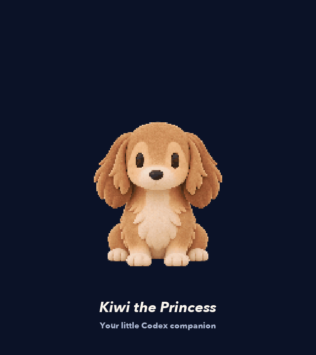

# Kiwi the Princess · 키위 공주



Kiwi is a long-haired dachshund pet for Codex, presented as a warm clay-style illustration. The native pet contains nine actions and sixteen gaze directions. Its 640 × 680 animation frames use a 2.5D layered illustration rig; this is not a full 3D model.

## Install the native pet

On macOS or Linux, run `./install.sh`. The script installs the validated pet package at `~/.codex/pets/kiwi-clay-r4/`. Its stable pet ID remains `kiwi-clay-r4` and its current Codex display name remains `키위 · 클레이`. An existing folder is copied to a timestamped backup under `~/.codex/pet-backups/` before replacement. Other pet folders are left in place.

```sh
git clone https://github.com/207studio-founder/kiwi-the-princess.git
cd kiwi-the-princess
./install.sh
```

Select **키위 · 클레이** in Codex after installation.

The packaged native pet is in `releases/kiwi-native-pet.zip`. To install manually, extract `pet.json` and `spritesheet.webp` into `~/.codex/pets/kiwi-clay-r4/`.

## 한국어 안내

### 설치

macOS 또는 Linux에서 `./install.sh`를 실행하면 검증된 펫 파일을 `~/.codex/pets/kiwi-clay-r4/`에 설치합니다. 안정 ID는 `kiwi-clay-r4`, Codex 표시 이름은 현재 `키위 · 클레이`입니다. 기존 폴더는 교체 전에 별도 백업 폴더에 복사하며 다른 펫 폴더는 그대로 둡니다. 직접 설치하려면 `releases/kiwi-native-pet.zip`의 `pet.json`과 `spritesheet.webp`를 대상 폴더에 압축 해제하세요.

위의 설치 명령을 실행한 다음 Codex에서 **키위 · 클레이**를 선택하세요.

### 로컬 뷰어

`releases/kiwi-atlas-viewer.zip`을 압축 해제하고 해당 폴더에서 `node server.mjs`를 실행한 뒤 `http://127.0.0.1:52130/`을 여세요. 다른 포트가 필요하면 `PORT=52131`을 지정합니다. 서버는 로컬에서만 열립니다.

### 아틀라스 다시 빌드

Python 3와 Pillow 12.3.0이 필요합니다. `python3 -m pip install -r requirements.txt`로 설치한 다음 `python3 build_atlas.py --selection selection.json --output build`를 실행하세요. 입력 프레임과 선택 정보는 저장소에 포함되어 있습니다.

## Run the local viewer

The viewer archive includes its own `build/` atlas and a small Node.js server. Extract `releases/kiwi-atlas-viewer.zip` to a folder, change into that folder, and run:

```sh
node server.mjs
```

Open `http://127.0.0.1:52130/`. Set `PORT=52131` before the command to use another port. The server listens on localhost and the viewer needs no external service.

## Rebuild the atlas

Python 3 and Pillow 12.3.0 are used by the reproducible atlas builder. Install the bounded dependency with `python3 -m pip install -r requirements.txt`, then run:

```sh
python3 build_atlas.py --selection selection.json --output build
```

The source frames and selection manifest are included. The generated `build/` folder is ignored by Git and is not duplicated in the source tree; prebuilt PNG and WebP atlases are available in the viewer release archive.

## Repository contents

- `activity-rig/`, `front-sit/`, `front-greet/`, `continuous-surface/`, and `right-facing/` contain source rigs, geometry, and supporting artwork.
- `inputs/` contains the selected frame artwork used by `selection.json`.
- `releases/` contains the native pet package and the standalone local viewer package.
- `media/kiwi-the-princess.gif` is the motion preview.
- `THREE-LICENSE.txt` retains the Three.js MIT notice for bundled Three.js code.

The earlier public project [`207studio-founder/kiwi-threejs-pet`](https://github.com/207studio-founder/kiwi-threejs-pet) is a previous version reference. Source files retain their existing attribution where present. See [ARTWORK.md](ARTWORK.md) for artwork provenance and scope. No license is granted for third-party artwork or other assets whose licensing is not stated by their source.
